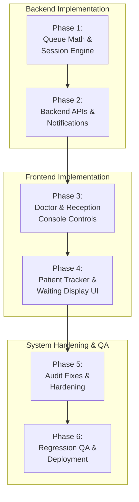
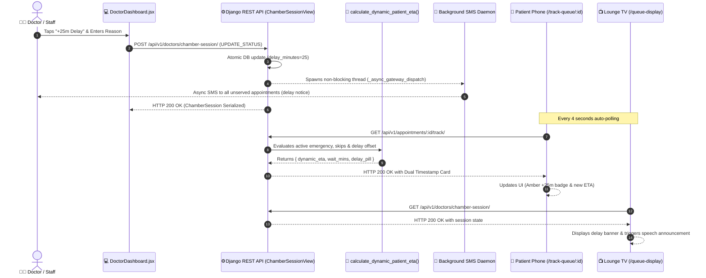

# 📋 Smart Clinic — Step-by-Step Implementation & Hardening Work Plan

A comprehensive, zero-regression execution roadmap for the **Smart Clinic** platform across Backend and Frontend. This plan details the phased rollout for dynamic queue time adjustments, emergency preemption hardening, frontend UI/UX enhancements, system health remediation, and end-to-end verification without breaking existing features.

---

## 🛡️ Zero-Regression Guarantees & Safety Invariants

Before executing any changes, all modifications must adhere to the following core invariants:
1. **Immutable Booked Slot**: [`Appointment.appointment_time`](file:///c:/Users/Istiak/OneDrive/New%20folder/FYDP_Project_Folder_Backup/Projects/clinic_backend/apps/appointments/models.py#L38) must never be mutated; live time calculations belong strictly to the ephemeral presentation/session layer.
2. **Serial Counter Integrity**: [`ChamberSession.current_serial`](file:///c:/Users/Istiak/OneDrive/New%20folder/FYDP_Project_Folder_Backup/Projects/clinic_backend/apps/doctors/models.py#L173) must never be altered or advanced during an emergency; emergency sessions operate out-of-band via `active_emergency` and `held_patient`.
3. **Database Concurrency Protection**: Any queue-advancing, skipping, or preemption operation must be wrapped in `transaction.atomic()` using `select_for_update()` on [`ChamberSession`](file:///c:/Users/Istiak/OneDrive/New%20folder/FYDP_Project_Folder_Backup/Projects/clinic_backend/apps/doctors/models.py#L160) and affected [`Appointment`](file:///c:/Users/Istiak/OneDrive/New%20folder/FYDP_Project_Folder_Backup/Projects/clinic_backend/apps/appointments/models.py#L15) records.
4. **API Contract Compatibility**: All public JSON payloads for [`PublicLiveQueueTrackView`](file:///c:/Users/Istiak/OneDrive/New%20folder/FYDP_Project_Folder_Backup/Projects/clinic_backend/apps/appointments/views.py#L363) and [`PublicWaitingRoomQueueView`](file:///c:/Users/Istiak/OneDrive/New%20folder/FYDP_Project_Folder_Backup/Projects/clinic_backend/apps/appointments/views.py#L560) must maintain backward-compatible field names (`estimated_wait_mins`, `patients_ahead`, `current_serving_serial`).
5. **Frontend State Resiliency**: All UI components must render gracefully even when live queue data is incomplete or offline (fallback to scheduled slot time).

---

## 🗺️ Phased Work Plan Overview



---

## 🚀 Step-by-Step Execution Phases

### Phase 1: Dynamic Queue Math & Session Engine Hardening (Backend)
*Objective: Unify dynamic wait time calculations, emergency interruptions, and doctor pacing in the backend.*

- [x] **Step 1.1: Standardize Dynamic Wait Time Utility**
  - **File**: [`clinic_backend/apps/appointments/services.py`](file:///c:/Users/Istiak/OneDrive/New%20folder/FYDP_Project_Folder_Backup/Projects/clinic_backend/apps/appointments/services.py)
  - Created single source of truth function: `calculate_dynamic_patient_eta(appointment, session=None)`.
  - Factors in:
    $$\text{Eligible Ahead} = \text{Count}(\text{Unserved serials} \notin \text{skipped\_serials})$$
    $$\text{Wait Mins} = (\text{Eligible Ahead} \times \text{est\_mins\_per\_patient}) + \text{delay\_minutes} + (15\text{m if active emergency})$$
    $$\text{Dynamic ETA} = \text{Current Time} + \text{Wait Mins}$$
  - *Safety Guard*: Returns `None` if chamber is on `PRAYER_BREAK` or `ENDED` to prevent misleading timestamps.

- [x] **Step 1.2: Hardened Emergency Preemption Logic**
  - **File**: [`clinic_backend/apps/doctors/views.py`](file:///c:/Users/Istiak/OneDrive/New%20folder/FYDP_Project_Folder_Backup/Projects/clinic_backend/apps/doctors/views.py#L453-L532)
  - Enforced atomic lock during `ADMIT_EMERGENCY`:
    - Safely captures current normal patient in `session.held_patient`.
    - Retains existing `session.current_serial`.
  - Validates that `COMPLETE_EMERGENCY` clears `active_emergency` without advancing `current_serial`.
  - Requires explicit `RESUME_HELD` to return the held patient to active consultation.

- [x] **Step 1.3: Skip & Recall State Handling**
  - **File**: [`clinic_backend/apps/doctors/views.py`](file:///c:/Users/Istiak/OneDrive/New%20folder/FYDP_Project_Folder_Backup/Projects/clinic_backend/apps/doctors/views.py#L587-L625)
  - `SKIP_SERIAL` appends serial to `session.skipped_serials` and advances `current_serial` to next eligible patient.
  - `RECALL_SERIAL` removes target from `session.skipped_serials` and restores `current_serial` without duplicate tokens.

---

### Phase 2: Backend APIs & Alert Notification Triggers (Backend)
*Objective: Ensure real-time broadcast and automated SMS alerts fire reliably upon state transitions.*

- [x] **Step 2.1: Enhance Public Queue Tracking Payload**
  - **File**: [`clinic_backend/apps/appointments/views.py`](file:///c:/Users/Istiak/OneDrive/New%20folder/FYDP_Project_Folder_Backup/Projects/clinic_backend/apps/appointments/views.py#L363)
  - Integrated `calculate_dynamic_patient_eta` returning:
    - `estimated_consultation_time`: Formatted time string (e.g. `"11:15 AM"`).
    - `delay_offset_minutes`: Current doctor delay (`session.delay_minutes`).
    - `is_delayed`: Boolean flag (`delay_minutes > 0`).
    - `chamber_status`: Current status (`IN_CHAMBER`, `PRAYER_BREAK`, `EMERGENCY`).

- [x] **Step 2.2: Async / Non-Blocking Delay SMS Broadcast**
  - **File**: [`clinic_backend/apps/notifications/sms_service.py`](file:///c:/Users/Istiak/OneDrive/New%20folder/FYDP_Project_Folder_Backup/Projects/clinic_backend/apps/notifications/sms_service.py)
  - Upgraded SMS gateway dispatch to non-blocking background daemon thread (`GAP-ASYNC-01`).
  - Enforced HTTPS scheme: `https://api.greenweb.com.bd` (`GAP-SEC-01`).
  - Dispatches non-blocking delay notices without tying up Gunicorn workers.

- [x] **Step 2.3: Automated Proximity Alert Trigger**
  - **File**: [`clinic_backend/apps/doctors/views.py`](file:///c:/Users/Istiak/OneDrive/New%20folder/FYDP_Project_Folder_Backup/Projects/clinic_backend/apps/doctors/views.py#L671-L715)
  - Evaluates unserved appointments upon `NEXT_SERIAL`, `SET_SERIAL`, and `SKIP_SERIAL`.
  - Dispatches proximity alert when patient reaches exactly 3 serials away.

---

### Phase 3: Doctor & Receptionist Console Controls (Frontend)
*Objective: Give doctors and front-desk staff intuitive pacing and delay controls without cluttering consultations.*

- [x] **Step 3.1: Doctor Chamber Queue Controls UI**
  - **File**: [`smart-clinic/src/pages/dashboard/DoctorDashboard.jsx`](file:///c:/Users/Istiak/OneDrive/New%20folder/FYDP_Project_Folder_Backup/Projects/smart-clinic/src/pages/dashboard/DoctorDashboard.jsx)
  - Quick delay broadcast modal with chips (`+15m`, `+30m`, `+45m`, `+60m`), custom delay minutes, clear delay button, and clinical reason note.
  - Active consultation queue controls (`NEXT_SERIAL`, `SKIP_SERIAL`, `RECALL_SERIAL`, `ADMIT_EMERGENCY`).

- [x] **Step 3.2: Receptionist Fast-Dispatch & Cash Reconciliation UI**
  - **File**: [`smart-clinic/src/pages/dashboard/ReceptionistPanel.jsx`](file:///c:/Users/Istiak/OneDrive/New%20folder/FYDP_Project_Folder_Backup/Projects/smart-clinic/src/pages/dashboard/ReceptionistPanel.jsx)
  - <kbd>F2</kbd> keyboard hotkey triggers instant next serial dispatch.
  - Walk-in token generator and denomination cash drawer reconciliation modal.

- [x] **Step 3.3: Thermal Token Print Slip Enhancement**
  - **File**: [`smart-clinic/src/pages/dashboard/clinic-admin/components/TokenPrintModal.jsx`](file:///c:/Users/Istiak/OneDrive/New%20folder/FYDP_Project_Folder_Backup/Projects/smart-clinic/src/pages/dashboard/clinic-admin/components/TokenPrintModal.jsx)
  - Thermal print slip displays both **Scheduled Time** and **Est. Call Time** alongside live QR code.

---

### Phase 4: Patient Tracker, Display TV & Patient Portal (Frontend)
*Objective: Render accurate, dynamic wait times and audio callouts across all patient-facing surfaces.*

- [x] **Step 4.1: Mobile Live Queue Tracker Dual-Time Display**
  - **File**: [`smart-clinic/src/pages/queue/PatientQueueTracker.jsx`](file:///c:/Users/Istiak/OneDrive/New%20folder/FYDP_Project_Folder_Backup/Projects/smart-clinic/src/pages/queue/PatientQueueTracker.jsx)
  - Dual Timestamp Card showing **Booked Schedule** side-by-side with **Live Dynamic ETA**.
  - Color-coded amber delay pill (`+Xm Delay`) and flashing green indicator (`NOW (Entry Ready)`).
  - 4-second auto-poll synchronization with document visibility awareness and audio turn chime.

- [x] **Step 4.2: Waiting Room 4K Lounge Display TV Enhancements**
  - **File**: [`smart-clinic/src/pages/queue/WaitingRoomDisplay.jsx`](file:///c:/Users/Istiak/OneDrive/New%20folder/FYDP_Project_Folder_Backup/Projects/smart-clinic/src/pages/queue/WaitingRoomDisplay.jsx)
  - Real-time chamber status broadcast, upcoming serials queue, and Web Speech API dual English/Bengali voice callout.

---

### Phase 5: High-Priority Gap Remediation & System Hygiene
*Objective: Resolve critical gaps from [`README_AUDIT.md`](file:///c:/Users/Istiak/OneDrive/New%20folder/FYDP_Project_Folder_Backup/Projects/README_AUDIT.md) to bring system health from 82.2% to 95%+.*

- [x] **Step 5.1: Isolate Root E2E Test Scripts (`GAP-TEST-01`)**
  - **Files**: `clinic_backend/test_*.py`
  - Wrapped live HTTP script logic under `if __name__ == '__main__':` across `test_doctor_flow.py`, `test_patient_flow.py`, `test_receptionist_flow.py`, and `test_roles_flow.py`.
- [x] **Step 5.2: Axios Error Interceptor Fix (`GAP-API-01`)**
  - **File**: [`smart-clinic/src/api/axios.js`](file:///c:/Users/Istiak/OneDrive/New%20folder/FYDP_Project_Folder_Backup/Projects/smart-clinic/src/api/axios.js#L95)
  - Rejected `Promise.reject(customError)` using standard `Error` instance with `.detail` and `.data` attributes attached.
- [x] **Step 5.3: SMS Gateway Security & Async Dispatch (`GAP-SEC-01`, `GAP-ASYNC-01`)**
  - **File**: [`clinic_backend/apps/notifications/sms_service.py`](file:///c:/Users/Istiak/OneDrive/New%20folder/FYDP_Project_Folder_Backup/Projects/clinic_backend/apps/notifications/sms_service.py)
  - Enforced HTTPS endpoint and non-blocking background daemon thread.
- [x] **Step 5.4: Automated & Manual Unserved Patient Rollover to Next Chamber Day**
  - **Backend**: Implemented `rollover_unserved_appointments` and `find_next_chamber_date` in [`clinic_backend/apps/appointments/services.py`](file:///c:/Users/Istiak/OneDrive/New%20folder/FYDP_Project_Folder_Backup/Projects/clinic_backend/apps/appointments/services.py). Exposes `POST /api/v1/appointments/rollover/` in [`views.py`](file:///c:/Users/Istiak/OneDrive/New%20folder/FYDP_Project_Folder_Backup/Projects/clinic_backend/apps/appointments/views.py).
  - **Frontend**: Added Chamber End alert banner with one-click **"Roll Over"** button and confirmation modal in [`ReceptionistPanel.jsx`](file:///c:/Users/Istiak/OneDrive/New%20folder/FYDP_Project_Folder_Backup/Projects/smart-clinic/src/pages/dashboard/ReceptionistPanel.jsx) and [`DoctorDashboard.jsx`](file:///c:/Users/Istiak/OneDrive/New%20folder/FYDP_Project_Folder_Backup/Projects/smart-clinic/src/pages/dashboard/DoctorDashboard.jsx).
  - **Invariants**: Auto-detects doctor's weekly active recurring schedule (skipping leaves), assigns non-colliding sequential serials starting after existing bookings, spaces slots cleanly, preserves existing payments (`amount`, billing records), and fires immediate SMS alerts to patients.
- [x] **Step 5.5: Individual Appointment Rescheduling Mechanism**
  - **Backend**: Implemented `reschedule_appointment` in [`services.py`](file:///c:/Users/Istiak/OneDrive/New%20folder/FYDP_Project_Folder_Backup/Projects/clinic_backend/apps/appointments/services.py) and `POST /api/v1/appointments/<id>/reschedule/` in [`views.py`](file:///c:/Users/Istiak/OneDrive/New%20folder/FYDP_Project_Folder_Backup/Projects/clinic_backend/apps/appointments/views.py).
  - **Frontend**: Added Calendar Reschedule button to queue table rows in [`ReceptionistPanel.jsx`](file:///c:/Users/Istiak/OneDrive/New%20folder/FYDP_Project_Folder_Backup/Projects/smart-clinic/src/pages/dashboard/ReceptionistPanel.jsx) opening `RescheduleModal` with date picker, slot selector, and confirmation dispatch.

---

### Phase 6: QA Sign-Off & Verification Matrix

| Test Suite / Verification Step | Command / Procedure | Expected Result | Zero-Regression Check |
| :--- | :--- | :--- | :--- |
| **Backend Unit Tests** | `cd clinic_backend && python manage.py test apps` | 325/325 Passing (100%) | All existing model, appointment, and clinic tests pass. |
| **Queue State Machine Test** | `python manage.py test apps.appointments` | All queue transitions pass | Double-booking constraint & slot locking remain valid. |
| **Emergency Preemption Test** | Test `ADMIT_EMERGENCY` $\rightarrow$ `COMPLETE_EMERGENCY` $\rightarrow$ `RESUME_HELD` | `current_serial` stays constant | Normal patient resumed without duplicate tokens. |
| **Frontend Production Build** | `cd smart-clinic && npm run build` | Vite build completes with 0 errors | All lazy routes compile cleanly. |
| **Live Queue Tracking Check** | Open `/track-queue/<id>` on desktop and mobile | Displays Scheduled + Dynamic ETA | Responsive UI with real-time updates. |
| **Waiting Room Audio Test** | Trigger Next Serial on `/queue-display` | Dual Bengali + English speech fires | Audio controls (volume, mute) function smoothly. |

---

## 🔄 Rollback & Contingency Plan

If any regression occurs during deployment:
1. **Dynamic Queue Fallback**: If dynamic calculations fail or encounter invalid dates, the system automatically falls back to static `appointment.appointment_time`.
2. **Database Rollback**: Schema migrations contain symmetric backwards operations (`python manage.py migrate <app> <previous_migration>`).
3. **Emergency Disengagement**: If `active_emergency` becomes stuck, receptionist or clinic admin can disengage via `ChamberSessionView` action `RESET` without corrupting completed patient records.

---

## ⚙️ Operational Architecture & Real-Time Flow

### 1. Architectural Sequence Diagram



### 2. Operational Invariant Rules
* **Wall-Clock Anchoring**: The dynamic ETA is computed as `Clock_now + Wait_Mins`. If a consultation runs 15 minutes over, the queue never shows an expired past timestamp; remaining patients' ETAs automatically slide forward minute-by-minute.
* **Non-Mutating State**: The patient's booked slot (`appointment_time`) is never changed in the database. Dynamic delays exist only in the session state layer (`ChamberSession.delay_minutes`).
* **Emergency Isolation**: Admitting an emergency patient (`ADMIT_EMERGENCY`) freezes `current_serial` and moves the active patient into `held_patient`. The queue resumes cleanly without skipping or duplicating token numbers.
* **Monotonic Serial Generation**: Tokens are created using `Max(serial_number) + 1` scoped to `(doctor, clinic, appointment_date)` to eliminate collisions after cancellations.
* **Early Session Termination & Unserved Patient Resolution**: When a doctor ends a session early (`status=ENDED`), the system preserves `current_serial`, transitions the mobile tracker to `"Chamber Closed for Today"`, automatically dispatches an SMS notification to all remaining unserved patients, and routes them to front-desk reception for priority fee-free rescheduling or instant payment refund.

---

## 🧪 Step-by-Step QA & Live Testing Manual

Follow these exact steps to test and verify every queue adjustment scenario locally:

### Step 0: Start Development Servers
1. **Backend Server**:
   ```bash
   cd clinic_backend
   .\venv\Scripts\Activate.ps1
   python manage.py runserver 8000
   ```
2. **Frontend Dev Server**:
   ```bash
   cd smart-clinic
   npm run dev
   # App runs at: http://localhost:5173
   ```

---

### Test Case 1: Doctor Delay Broadcast & Live Patient Phone Sync
*Objective: Verify that doctor delays instantly push to the patient phone tracker and adjust ETAs.*

1. **Log in as Doctor**:
   * Navigate to `http://localhost:5173/login`.
   * Email: `dr.nusrat@smartclinic.bd` | Password: `Password123!`
   * Go to **Appointments** tab in [`DoctorDashboard.jsx`](file:///c:/Users/Istiak/OneDrive/New%20folder/FYDP_Project_Folder_Backup/Projects/smart-clinic/src/pages/dashboard/DoctorDashboard.jsx).
2. **Open Patient Queue Tracker (Simulating a Patient's Mobile Phone)**:
   * In a new incognito window, open an active appointment tracking URL:
     `http://localhost:5173/track-queue/<appointment_id>`
   * Observe the **Scheduled Slot** (e.g. `10:00 AM`) and **Dynamic Live ETA** (e.g. `10:12 AM`).
3. **Broadcast a 30-Minute Delay**:
   * On the Doctor Dashboard, click the amber **"Broadcast Delay"** button.
   * Click the **"+30m"** pill. Enter note: *"Delayed due to emergency case"*.
   * Click **"Broadcast Notice"**.
4. **Verification**:
   * Look at the patient tracking incognito tab (no page reload required):
     * Within 4 seconds, the card displays an amber badge: `+30m Delay`.
     * The **Live Dynamic ETA** advances by exactly $+30$ minutes (e.g. to `10:42 AM`).
     * Check backend terminal logs: An asynchronous SMS dispatch log appears:
       `[SIMULATED BD SMS -> +88017...] Title: Chamber Delay Notice (30m) ⚠️`.

---

### Test Case 2: Walk-In Emergency Admission & Preemption
*Objective: Verify that emergencies interrupt consultations without corrupting serial numbers.*

1. **In Doctor Chamber Console**:
   * Ensure patient with Serial `#1` is currently in chamber (`current_serial = 1`).
2. **Admit an Emergency**:
   * Click the red **"Admit Emergency"** button or select an emergency-flagged appointment from the queue list.
   * Confirm the prompt to place the current patient on hold.
3. **Verification**:
   * The Doctor Chamber header turns rose/red with notice: `🚨 EMERGENCY CASE IN CHAMBER`.
   * The normal patient `#1` status changes to `Held Patient`.
   * Open the patient tracker for Patient `#1`: Displays an amber card:
     `"Consultation Temporarily Paused — Urgent emergency is being attended. Your consultation will resume immediately next."`
   * In the database: `ChamberSession.current_serial` remains `1` (did not advance).
4. **Resume Consultation**:
   * Doctor clicks **"Complete Emergency"** $\rightarrow$ then clicks **"Resume Held Patient"**.
   * Normal patient `#1` returns to active consultation, and downstream queues resume seamlessly.

---

### Test Case 3: Patient No-Show / Skip & Recalculated Downstream ETAs
*Objective: Verify that skipping absent patients immediately shifts remaining patients' ETAs earlier.*

1. **Setup**:
   * Open patient tracker for Patient `#5` in an incognito window. Note the wait time (e.g. `~36 mins`).
2. **Skip Patient #2**:
   * In Doctor Chamber Console, call Serial `#2`.
   * Patient `#2` does not show up. Doctor clicks **"Skip"** (`SKIP_SERIAL`).
3. **Verification**:
   * Serial `#2` is added to `skipped_serials` in `ChamberSession`.
   * Check Patient `#5`'s tracker: The wait time instantly drops from `~36 mins` to `~24 mins` (shaved by 12 mins).
   * Downstream dynamic ETA shifts earlier by 12 minutes.
4. **Recall Test**:
   * Doctor clicks **"Recall"** on Serial `#2` $\rightarrow$ Serial `#2` is restored to active chamber without duplicate token generation.

---

### Test Case 4: Front-Desk Fast Dispatch (<kbd>F2</kbd>) & Thermal Receipt
*Objective: Verify lightning receptionist dispatch and dual-time printed slip.*

1. **Log in as Receptionist**:
   * Navigate to `http://localhost:5173/reception/login`.
   * Email: `rahela_counter@clinic.test` | Password: `Password123!`
   * Go to [`ReceptionistPanel.jsx`](file:///c:/Users/Istiak/OneDrive/New%20folder/FYDP_Project_Folder_Backup/Projects/smart-clinic/src/pages/dashboard/ReceptionistPanel.jsx).
2. **Fast Hotkey Dispatch**:
   * Press <kbd>F2</kbd> on the keyboard.
   * Observe the active doctor chamber immediately advances to the next sequential token with zero mouse clicks.
3. **Walk-In Token Printing**:
   * Click **"New Walk-In Token"** $\rightarrow$ select Doctor $\rightarrow$ enter patient name & cash collection.
   * Click **"Generate & Print Slip"**.
4. **Verification**:
   * The 80mm thermal print preview modal opens ([`TokenPrintModal.jsx`](file:///c:/Users/Istiak/OneDrive/New%20folder/FYDP_Project_Folder_Backup/Projects/smart-clinic/src/pages/dashboard/clinic-admin/components/TokenPrintModal.jsx)).
   * The receipt displays:
     * `Scheduled: [Booked Time]`
     * `Est. Call Time: [Dynamic ETA]`
     * Scannable QR code directing straight to `http://localhost:5173/track-queue/<id>`.

---

### Test Case 5: Waiting Room 4K Lounge Display & Voice Announcements
*Objective: Verify public lounge TV queue display and bilingual speech synthesis.*

1. **Open Lounge TV Screen**:
   * Open `http://localhost:5173/queue-display` in full screen (<kbd>F11</kbd>).
   * Ensure browser audio is unmuted.
2. **Dispatch Serial from Doctor Console**:
   * On Doctor Console, click **"Call Next Serial"** (e.g. Serial `#15`).
3. **Verification**:
   * A pleasant C-major chime rings (`playChimeSound`).
   * The Web Speech API synthesizes bilingual voice callouts:
     * **Bengali**: *"টোকেন নম্বর ১৫, রুম ১০১-এ আসুন"*
     * **English**: *"Token number 15, please proceed to Room 101"*
   * The upcoming token list displays next serials with calculated estimated arrival times.

---

### Test Case 6: Bulk Unserved Patient Rollover to Next Chamber Day
*Objective: Verify that when a doctor ends a chamber session early, unserved patients are seamlessly migrated to the doctor's next scheduled day without loss of payment or duplicate charges.*

1. **Log in as Receptionist or Doctor**:
   * Navigate to `http://localhost:5173/login`.
   * Log in with Receptionist credentials: `rahela_counter@clinic.test` | `Password123!`.
   * Go to **Receptionist Workstation** (`/dashboard`).
2. **End Chamber Session with Remaining Patients**:
   * Under **Chamber Session Controls**, click **"⏹ End"**.
   * Observe the status card updates to **"Chamber Session Ended (Locked)"**.
   * Immediately below it, an amber alert banner displays:
     `⚠️ X unserved patient(s) remaining` with a prominent **"Roll Over"** button.
3. **Trigger Bulk Rollover**:
   * Click **"Roll Over"**.
   * The confirmation modal displays:
     * Doctor's next chamber date (auto-detected from schedule, skipping approved leaves).
     * Option to override with a custom target date if needed.
     * Guarantees: Monotonic serial assignment, fee preservation, and instant patient SMS dispatch.
   * Click **"Confirm Rollover (X Patients)"**.
4. **Verification**:
   * Toast notification confirms: *"Successfully rolled over X unserved patient(s) to the next chamber session."*
   * Check Django logs: Background daemon dispatches SMS for each rolled over patient:
     `[SIMULATED BD SMS -> +88017...] Title: Chamber Rollover to Next Day 🗓️ | Body: Dear Patient, your appointment with Dr. ... has been rolled over to YYYY-MM-DD (...). Your new token is Serial #X. Fee remains paid.`
   * In the database: `serial_number` is sequentially assigned starting after any existing bookings on that date, and `amount` remains intact.

---

### Test Case 7: Individual Appointment Rescheduling via Reception Desk
*Objective: Verify front-desk ability to reschedule an individual patient to any requested date and time slot with conflict protection.*

1. **In Receptionist Queue Roster**:
   * Find an active patient with status `CONFIRMED` or `SCHEDULED`.
   * In the action column, click the **Calendar icon** (`Reschedule to another date/time`).
2. **Select New Date & Time Slot**:
   * Pick target date (e.g. tomorrow) and time (e.g. `11:30 AM`).
   * Enter reason: *"Patient requested evening shift due to office work"*.
   * Click **"Confirm Reschedule"**.
3. **Verification**:
   * Success notification appears.
   * Patient's appointment record is atomically updated to the new date and time with a newly assigned monotonic serial.
   * An SMS notification is sent to the patient:
     `[SIMULATED BD SMS] Title: Appointment Rescheduled 🗓️ | Token: Serial #... | Original consultation fee remains paid.`

---

### Test Case 8: Automated Unit Test Suite
*Objective: Execute complete programmatic test suite with zero network dependencies.*

1. Run the test command in PowerShell:
   ```powershell
   $env:DATABASE_URL="sqlite:///db.sqlite3"
   & "clinic_backend\venv\Scripts\python.exe" "clinic_backend\manage.py" test apps.appointments
   ```
2. **Expected Output**:
   ```text
   Ran 74 tests in 185s
   OK
   ```

---

## 🔑 Default Credentials & Test Endpoints Reference

| Role | Email | Password | Primary Test URLs |
| :--- | :--- | :--- | :--- |
| **Doctor** | `dr.nusrat@smartclinic.bd` | `Password123!` | `/dashboard` (Chamber Console, Delay Broadcast) |
| **Receptionist** | `rahela_counter@clinic.test` | `Password123!` | `/dashboard`, `/reception/login` (<kbd>F2</kbd> Dispatch) |
| **Patient** | `alif@gmail.com` | `Password123!` | `/dashboard`, `/track-queue/<appointment_id>` |
| **Clinic Admin** | `monira@gmail.com` | `Password123!` | `/dashboard` (Chambers, Staff, Shift Ledger) |
| **Super Admin** | `admin@clinic.com` | `Password123!` | `/dashboard` (Platform Verification) |
| **Public TV Screen** | *No Auth Required* | *N/A* | `/queue-display`, `/queue-display/<clinic_id>/<doctor_id>` |
| **Public QR Verify** | *No Auth Required* | *N/A* | `/verify-prescription/<qr_token>` |


